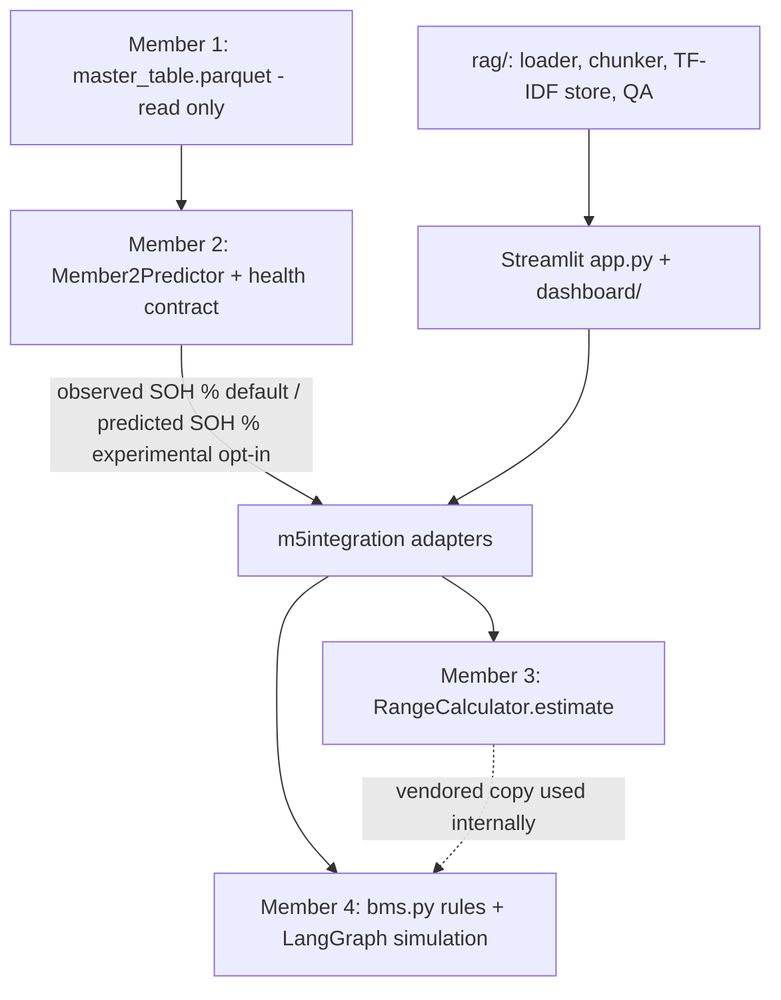
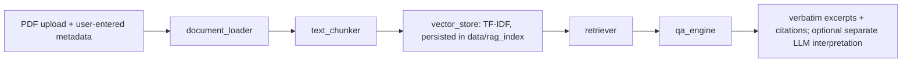
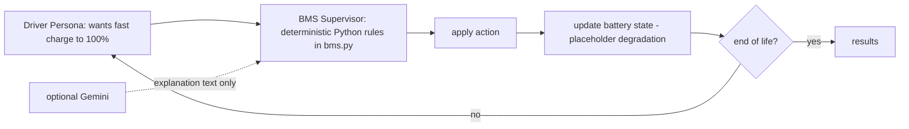

# Architecture (Member 5 integration)

## Data flow

## Multi-agent interaction (Member 4)

## Boundaries enforced in code
- `member2_adapter.soh_for_range`: only `ok`/`ok_experimental` Member 2 results can feed range; observed SOH is the default; predicted SOH is labelled experimental; blocked results raise `RangeBlocked`.
- `member2_adapter.rul_signal` always returns `None` (RUL not approved).
- Member 3 is called with SOH in percent and speed already in m/s (cycle CSVs); no unit conversion needed.
- Safety decisions come only from `ev_member4/bms.py`; the LLM never changes them.
- Cell-level Ah is never converted to pack kWh; pack energy comes from the vehicle JSON.
